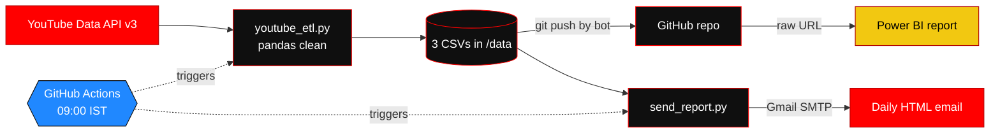

<div align="center">


**A creator analytics pipeline that updates itself daily and emails you the results.**
YouTube API in. Clean CSVs, a Power BI dashboard and an HTML report out. No manual steps.

<br/>


<br/>

[](https://github.com/DishantBhere/YT-AUTO/raw/main/powerbi/YT_Creator_Analytics.pbix)
[](https://github.com/DishantBhere/YT-AUTO/actions)

</div>

---

## At a glance

<div align="center">

| 9 | 6,500+ | 3 | 1 | 0 |
|:---:|:---:|:---:|:---:|:---:|
| **creators tracked** | **videos analysed** | **clean CSV tables** | **email every morning** | **manual steps** |

</div>

---

## Dashboard preview


<details>
<summary><b>See the other two pages</b></summary>
<br/>


</details>

---

## The daily email

Every run ends with an HTML report in your inbox, styled black and red to match the repo. A failed run sends a red **FAILED** email with a link to the log, so a broken pipeline never goes unnoticed.

| Block | What it shows |
|---|---|
| **KPI cards** | Channels, total subscribers, total views, videos tracked, each with the change since the previous snapshot |
| **Top 5 channels** | Ranked by subscribers |
| **Top movers** | Channels with the most views gained between the last two snapshots |
| **Top new videos** | Best performing uploads from the last 7 days |
| **Buttons** | Run log, repo, and a direct dashboard download |

> Preview it locally without sending anything: `DRY_RUN=1 python python/send_report.py` writes `email_preview.html`.

---

## What it answers

| Question | Source table |
|---|---|
| Who has the most subscribers and views right now? | `youtube_channels.csv` |
| Which videos perform best on views, likes and comments? | `youtube_videos.csv` |
| How fast is each channel growing day over day? | `youtube_history.csv` |

**Creators tracked:** codebasics, Alex The Analyst, techTFQ, Bas Dohmen | Data Training, LearnWidGiggs, Krish Naik, Darshil Parmar, Ankit Bansal, Analytics with Nags.

---

## Architecture



**Design rule:** Python makes CSVs and the email. Power BI only visualises. GitHub Actions glues it together. Nothing is edited by hand.

### Daily timeline

```text
09:00 IST  Action starts
   |       1. Extract    YouTube API, batches of 50 videos
   |       2. Clean      ints, dates, dedupe
   |       3. Load       atomic CSV write
   |       4. Commit     bot pushes data/*.csv
   v       5. Email      HTML report to your inbox
09:10 IST  Hit Refresh in Power BI, new numbers are live
```

---

## Quick start: see the dashboard in a minute

1. [Download `YT_Creator_Analytics.pbix`](https://github.com/DishantBhere/YT-AUTO/raw/main/powerbi/YT_Creator_Analytics.pbix)
2. Open it in [Power BI Desktop](https://powerbi.microsoft.com/desktop/) (free, Windows).
3. Click **Home, then Refresh**. If asked for credentials, pick **Anonymous** and **Connect**.

No account, no API key. The repo is public and the CSVs are read anonymously.

---

## Repository structure

```text
YT-AUTO/
├── .github/workflows/
│   └── youtube_update.yml         daily automation
├── data/
│   ├── youtube_channels.csv       latest channel stats
│   ├── youtube_videos.csv         latest video stats
│   └── youtube_history.csv        daily snapshots, grows every day
├── powerbi/
│   ├── YT_Creator_Analytics.pbix  ready to open
│   ├── YT_Creator_Analytics.pbip  git-friendly source project
│   ├── *.Report/                  report definition
│   └── *.SemanticModel/           data model
├── python/
│   ├── youtube_etl.py             extract, clean, write CSV
│   └── send_report.py             builds and sends the HTML email
├── requirements.txt
└── README.md
```

---

## Data model

| Table | Grain | Columns |
|---|---|---|
| `youtube_channels` | one row per channel, latest | `Channel_ID` `Channel_Name` `Subscribers` `TotalVideos` `Views` `playlist_id` |
| `youtube_videos` | one row per video | `VideoID` `Channel_ID` `Channel_Name` `VideoTitle` `Published_date` `Views` `Likes` `Comments` |
| `youtube_history` | one row per channel per day | `Snapshot_Date` `Channel_ID` `Channel_Name` `Subscribers` `TotalVideos` `Views` |

`Channel_ID` joins all three tables.

---

## Built to not break

| Safety rule | Why it matters |
|---|---|
| **Atomic writes** | CSVs go to a temp file, then replace. A crash never leaves a half-written file. |
| **Empty API guard** | If the API returns nothing, the run aborts and old CSVs stay untouched. |
| **Per-channel fallback** | One channel fails, its old rows are kept while the rest update. |
| **One row per day** | Re-running on the same day overwrites that day, never duplicates it. |
| **No commit on failure** | A failed ETL pushes nothing. |
| **Failure email** | The mail step uses `if: always()`, so you hear about errors too. |
| **Rebase conflict safe** | The bot rebases with `-X theirs`, so fresh generated CSVs win over a stale copy. |

---

## Run it yourself

**You need:** Python 3.12+ and a [YouTube Data API v3 key](https://console.cloud.google.com/apis/library/youtube.googleapis.com).

```bash
git clone https://github.com/DishantBhere/YT-AUTO.git
cd YT-AUTO
pip install -r requirements.txt
```

Create `.env` in the project root (already git-ignored):

```text
YOUTUBE_API_KEY=your_key_here
```

```bash
python python/youtube_etl.py
```

### Turn on automation for your fork

1. **Settings, Secrets and variables, Actions.** Add these repository secrets:

   | Secret | Value |
   |---|---|
   | `YOUTUBE_API_KEY` | your API key |
   | `MAIL_USER` | Gmail address that sends the report |
   | `MAIL_PASS` | Gmail **app password** (needs 2FA, no spaces) |
   | `MAIL_TO` | recipient, comma separated for several |

2. **Settings, Actions, General, Workflow permissions:** set to **Read and write**.
3. **Actions** tab, *Daily YouTube ETL*, **Run workflow** to test.

### Track your own channels

Edit `CHANNELS` in `python/youtube_etl.py`:

```python
CHANNELS = {
    "UC_channel_id_here": "Channel Name",
}
```

---

## Keeping the dashboard fresh

| Step | When |
|---|---|
| Action updates CSVs and sends the email | Daily, 09:00 IST |
| GitHub raw cache settles | about 5 min after the commit |
| You click **Refresh** in Power BI | any time after 09:10 IST |

Raw URLs never change. Same link, new contents, so the layout stays as you built it.

---

## Troubleshooting

<details>
<summary><b>Open the fixes</b></summary>
<br/>

| Problem | Fix |
|---|---|
| Power BI: *Unable to connect to the remote server* | Open a raw CSV URL in the browser. If it fails, change DNS to `1.1.1.1` or `8.8.8.8`, or toggle VPN. |
| Power BI asks for credentials | Set **Anonymous** in *Data source settings*. |
| `git push` returns 403 in Actions | Set workflow permissions to **Read and write**. |
| `CONFLICT (content)` during rebase in Actions | Someone pushed while the run was going. The `-X theirs` rebase in the workflow handles it. |
| `git push` rejected locally | Run `git pull` first. The bot commits data daily. Better: never commit `data/*.csv` by hand. |
| `MAIL_USER / MAIL_PASS / MAIL_TO missing` | Secrets are per repo. Add all three to this repo. |
| `SMTPAuthenticationError` | Use a Gmail app password, pasted without spaces. |
| `quotaExceeded` or API 403 | Enable YouTube Data API v3 and check key restrictions. |
| Subscribers delta always `+0` | YouTube rounds public subscriber counts, so daily change is often zero. Views gained is the reliable growth signal. |

</details>

---

## Tech stack

| Layer | Tool |
|---|---|
| Language | Python 3.12 |
| Data | pandas, google-api-python-client |
| Source | YouTube Data API v3 |
| Automation | GitHub Actions (cron) |
| Email | smtplib over Gmail SSL |
| BI | Power BI (PBIP source, PBIX download) |

---

## Roadmap

- [x] Daily automated ETL with safe writes
- [x] Daily HTML email report with failure alerts
- [ ] More creators and a category dimension
- [ ] Engagement rate and upload frequency metrics
- [ ] Data quality checks inside the ETL
- [ ] Live web version of the report

---

<div align="center">

Released under the [MIT License](LICENSE).

**Built by [Dishant Bhere](https://github.com/DishantBhere)**
If this saved you time, a star helps.

</div>
